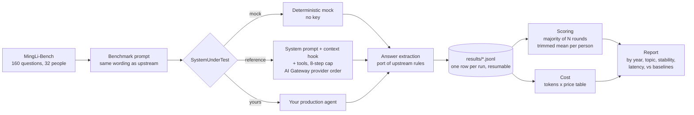

# mingli-bench-harness

A harness that runs an AI agent against MingLi-Bench, a benchmark of 160 multiple-choice Bazi (Chinese astrology) questions about real people, and reports accuracy, answer stability, latency and cost.

## The problem

The Modern Shrine's production chat agent reads a person's Chinese birth chart and answers questions about career, money and relationships. Until this study it had only been tested by reading its answers. There was no number, so nobody could tell whether a change to the prompt or the model made it better or worse.

[MingLi-Bench](https://github.com/DestinyLinker/MingLi-Bench) gives a number. It is built from the Global Fortune Teller Competition (2022 to 2025): 32 real people, five questions each, about things that actually happened to them, with one correct answer per question from the official answer key. Published baselines exist for the 2025 questions (top human practitioners, the Tianfu Agent, Claude Opus 4.6 without tools).

## Approach

The runner calls the agent the way the product does, without the parts that do not affect the answer. In the original study it reused the production code directly: the chart service, the full system prompt, knowledge-base retrieval, the same three tools and 8-step limit, and the same model (Kimi K2.5) with the same AI Gateway provider order. Login, bot checks, rate limits, saving messages, title generation and analytics were skipped.

This repository is that runner made standalone. The agent sits behind a small `SystemUnderTest` interface, so any agent can be put through the same questions and the same scoring.



Scoring follows the Tianfu Agent report:

- **5 independent runs** per 2025 question (`--rounds 5`)
- A question counts as correct only if **at least 3 of 5 runs** got it right
- **Trimmed mean**: accuracy per person, drop the best and the worst person, average the rest

The report also counts how many questions got the same answer on every round, and how many runs ended with no extractable answer.

## Results

From the published study of The Modern Shrine's production agent (Kimi K2.5). The run rows are committed in `results/published/` (response text removed), and `npm run score:published` recomputes every number below from them.

| 2025 competition (8 people, 40 questions) | Trimmed mean |
|---|---|
| Top 20 human practitioners (of 3,069) | 53.5% |
| Tianfu Agent | 50.0% |
| Claude Opus 4.6, no tools | 40.0% |
| **The Modern Shrine agent** | **36.7%** |
| Random guessing | 25.0% |

Baselines are the published numbers; they were not re-run.

- **360 agent runs** scored: 200 for the 2025 five-run test, 160 for one run of every question. 4.3 million input tokens and 325,000 output tokens, about **$3.55** at list price, about one cent per answer.
- All four years: **60 of 160** correct (37.5%). Retrying the four runs that returned no answer moved this to 61 of 160 and left the 2025 score unchanged.
- Median answer time about **10 seconds**.
- Stability: only **12 of 40** 2025 questions got the same answer on all five runs.
- **4 of 360** runs returned no answer: two ended on a line announcing a tool call the model never made, two came back empty. This was a production bug that manual testing had missed.

| Stronger topics | Weaker topics |
|---|---|
| Family: 59% (22 questions) | Marriage: 30% (44 questions) |
| Personality: 57% (14) | Money: 23% (13) |
| Career: 48% (25) | Education: 18% (11) |

40 questions is a small set: one question moves the 2025 score by 2.5 points. The gap to Opus 4.6 is within noise; the gap to Tianfu is not.

## Quickstart

Needs Node 22.9 or later. No API key.

```sh
npm install
npm run quickstart        # 5 questions, mock model, writes results/quickstart.report.md
npm test                  # unit tests + checks that the published numbers reproduce
npm run score:published   # rebuild the study's report from the committed run rows
```

The mock picks letters from a hash, so it scores near random. It is there to exercise the runner, scoring, cost and report end to end.

To run a real model through the reference agent:

```sh
cp .env.example .env      # add AI_GATEWAY_API_KEY
npm run bench -- --sut reference --model moonshotai/kimi-k2.5 \
  --gateway-order fireworks,bedrock --year 2025 --sample 5 --max-usd 0.25
```

The full five-run 2025 test is `--year 2025 --rounds 5`. Results append to `results/<out>.jsonl`, so an interrupted run resumes where it stopped. `--max-usd` stops starting new runs once the estimated spend reaches the cap (prices in `src/pricing.ts`, or `--price-in` / `--price-out`).

### Putting your own agent under test

Implement `SystemUnderTest` (`src/types.ts`) and register it in `makeSut` in `src/cli.ts`:

```ts
const mine: SystemUnderTest = {
  name: "my-agent",
  model: "provider/model-id",            // used for cost lookup
  async answer({ question, userPrompt }) {
    const r = await myAgent.run(userPrompt);
    return { text: r.text, steps: r.steps, toolCalls: r.tools,
             contextChunks: r.ragChunks, usage: r.usage };
  },
};
```

For a production agent, call the same functions the product calls (chart, retrieval, prompt builder) rather than re-creating them; a test is only fair if the agent sees what a real user's request would give it. The reference agent shows the shape, with a `ContextProvider` hook for chart and retrieval context.

## Repo layout

```
src/
  cli.ts                 flags, run or score-only
  runner.ts              concurrency, resume, spend cap, one JSONL row per run
  benchmark.ts           data loading, upstream prompt wording, answer extraction
  score.ts               majority vote, trimmed mean, stability, report
  pricing.ts             price table and cost totals
  types.ts               SystemUnderTest and row types
  sut/mock.ts            deterministic mock, no key
  sut/reference-agent.ts example prompt + context hook + tools via AI SDK / AI Gateway
  sut/tools.ts           stub calendar and date tools
prompts/example-system-prompt.md
data/mingli-bench/       MingLi-Bench data.json + MIT licence (see NOTICE.md)
results/published/       run rows from the published study, response text removed
scripts/download-mingli-bench.sh   re-download or verify the data at a pinned commit
examples/newsletter-agent/         a rubric-graded Managed Agent config (no answer key)
test/                    node:test suites
```

## What is not here

- **The production system prompt and knowledge base are private.** `prompts/example-system-prompt.md` is a short stand-in. The reference agent with this prompt is a different system from the one measured, and will not reproduce 36.7%.
- **The chart service** that computes the four pillars, luck periods and clashes is not included. The reference agent's tools are stubs with the same names (`getChineseCalendarData` returns the year pillar only). Plug a real chart into the `ContextProvider` hook.
- The product app, user data and the model responses from the study.

## Design decisions

- **Reuse, don't re-create.** The original runner imported the product's own prompt builder, retrieval and tools instead of copying them, so the benchmark measured the code users hit. The harness keeps that boundary as one interface.
- **Upstream prompt and extraction, unchanged.** Comparing against published baselines only works with the benchmark's own wording and parsing rules, so both are direct ports.
- **Rows first, scores later.** Every run is a JSONL row with tokens, steps, tool calls and latency. Scoring is a pure function of the file, so a new metric can be added without re-running the model, and partial runs resume.
- **Stability is a first-class metric.** A single accuracy number hid that 28 of 40 questions changed answer between runs. Counting same-answer questions shows whether a change makes the agent more decisive, not just luckier.
- **Cost is tracked per row** so a model comparison reports price next to accuracy, and a spend cap stops runaway runs.

## What I'd do next

1. Detect answers that are empty or end in narration and ask the model to continue, then re-score.
2. Run the same questions across several models (one flag) and publish the accuracy-cost table.
3. Add timing-rule tools for marriage and money, the weakest topics.
4. Add a reconcile step that runs several readings and makes a final step choose between them; success shows up as more same-answer questions, not only a higher score.
5. A confidence-interval line in the report (bootstrap over people), since 40 questions is small.

## Article

[The Modern Shrine's AI agent on the Global Fortune Teller Competition benchmark: 36.7%](https://tonytonggg.com/writing/benchmarking-the-modern-shrine-agent)

## Licence

MIT, Copyright (c) 2026 Tony Tong. MingLi-Bench data and ported prompt / extraction code are MIT, Copyright (c) 2026 MingLi-Bench Contributors; see `NOTICE.md`.
